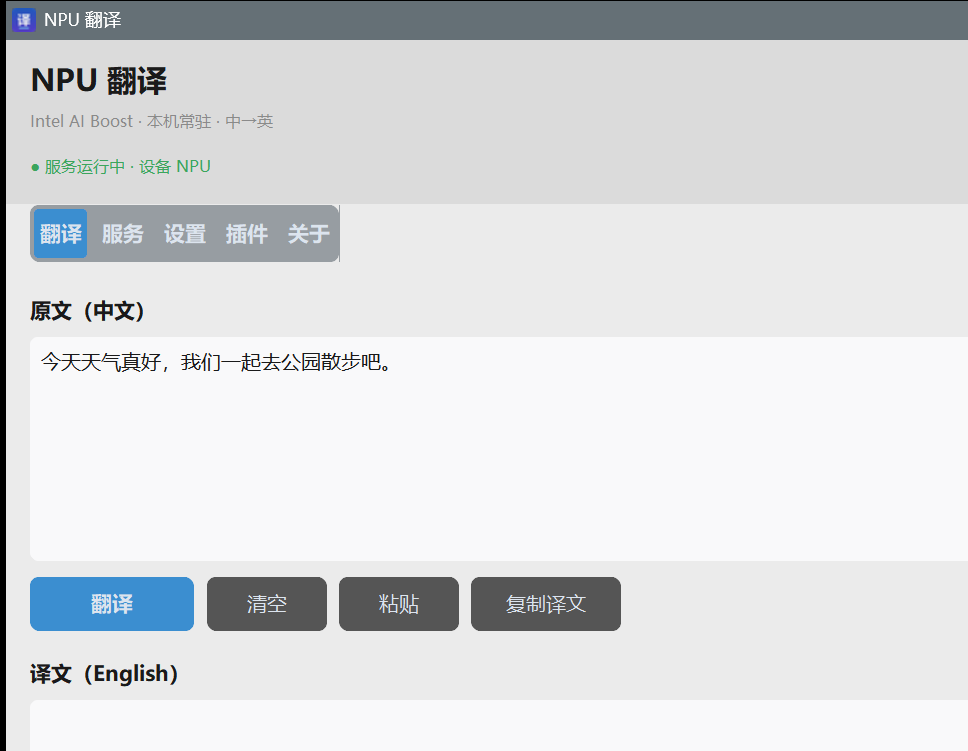

# NPU 常驻翻译

在 Intel **NPU**（Intel AI Boost）上跑极轻量中英翻译，目标是**省电 / 可常驻**，不是拼速度。

纯本地推理，不联网、不调云 API；把 NPU 交给翻译，独显可以完全休眠。



## 实测数据

测试平台：Intel Core Ultra 9 275HX（Intel AI Boost NPU）+ OpenVINO 2026.4 + MarianMT `opus-mt-zh-en`

| 指标 | NPU | CPU 对照 |
|---|---|---|
| 吞吐 | **375.8 句/分钟** | 129.5 句/分钟 |
| 延迟均值 | **158 ms** | 460 ms |
| 延迟 P50 | **141 ms** | 427 ms |
| 最快单句 | 89 ms | 251 ms |
| 空闲 CPU | **0 %** | — |
| 常驻内存 | 约 5 MB（WorkingSet） | — |

**NPU 比同模型 CPU 快 46%**，同时几乎不占 CPU —— 这正是「省电常驻」的实测依据。

### 序列长度分档（关键优化）

NPU 只接受全静态形状，padding 浪费会直接变成延迟。因此按源句 token 数自动选档：

| 档位 | 延迟（20 句均值） |
|---|---|
| 64x64 | 153 ms |
| 96x96 | 190 ms |
| 128x128 | 248 ms |

分档后压测均值从 248 ms 降到 **158 ms**，吞吐翻倍。

## 特性

- **NPU 推理**：OpenVINO 在 Intel AI Boost 上跑 MarianMT，无需独显
- **图形界面**：CustomTkinter 现代界面，可调设备 / 档位 / 端口 / 开机自启 / 后台服务
- **模型管理**：界面内查看已装模型、一键切换、下载并转换新模型（中→英 / 英→中 / 日→中等）
- **常驻服务**：界面关闭后服务继续跑；空闲 CPU 0%
- **双协议**：TCP 8715（GUI/客户端）+ HTTP 8716（浏览器插件）
- **浏览器插件兼容**：实现 [kiss-translator 自定义接口规范](https://github.com/fishjar/kiss-translator/blob/master/custom-api_v2.md)，Hook 全留空即可用
- **系统托盘**：右键菜单开界面 / 起停服务
- **可打包**：`build.ps1` 一键生成独立 exe（PyInstaller）

## 快速开始

### 1. 准备环境

```powershell
git clone https://github.com/djj12589/nput-translate.git
cd nput-translate
.\setup.ps1            # 创建 .venv 并安装运行时依赖
```

### 2. 导出模型（约 445 MB，不入库）

```powershell
.\export_model.ps1     # Helsinki-NLP/opus-mt-zh-en → models\opus-mt-zh-en-ov
```

### 3. 运行

```powershell
.\启动服务.bat                                    # 起后台服务
.\.venv\Scripts\python.exe client.py --text "外面下雨了，记得带伞。"
.\.venv\Scripts\python.exe gui.py                 # 图形界面
```

起托盘常驻：

```powershell
powershell -NoProfile -WindowStyle Hidden -ExecutionPolicy Bypass -File .\tray.ps1
```

### 打包成 exe

```powershell
.\build.ps1            # 产物在 dist\NPU翻译\
```

### 生成安装程序

```powershell
.\build_installer.ps1  # 产物 dist\NPU翻译-安装程序-<版本>.exe（约 103 MB）
```

安装程序用 Inno Setup 6 制作，特性：

- **可自选安装目录**（默认 `%LOCALAPPDATA%\Programs\NPU 翻译`，免管理员）
- 可选创建桌面快捷方式、可选开机自启服务
- 自带卸载程序，卸载会清理配置与日志
- 安装前自动结束正在运行的服务与界面，避免文件占用

### 为什么安装包只有 103 MB

安装包**不内置模型**，只带推理框架；模型在程序「模型」页一键下载（197 MB FP16 包）。
详细拆解见 [BUILD.md](BUILD.md)「安装包体积构成」。

## 服务协议

### TCP 8715（换行分隔 JSON）

```
{"text": "今天天气真好"}   →   {"ok":true,"src":"...","dst":"...","ms":158.0,"tier":"64x64"}
{"cmd": "status"}          →   {"ok":true,"device":"NPU","tiers":[...],"uptime_s":12.3}
```

### HTTP 8716（浏览器插件 / 调试）

| 端点 | 方法 | 说明 |
|---|---|---|
| `/translate` | POST / GET | kiss 非聚合翻译 |
| `/translate/batch` | POST / GET | 聚合翻译 |
| `/status` | GET | 设备、档位、运行时长 |
| `/selftest` | GET | 完整自检（含失败 traceback） |
| `/devices` | GET | 可用 OpenVINO 设备 |
| `/ping` | GET | 存活探测 |
| `/shutdown` | POST | 优雅停止 |

地址栏直接测：

```
http://127.0.0.1:8716/translate?text=今天天气真好&to=en
```

浏览器插件接入见 [KISS.md](KISS.md)。

## 语言方向

当前只装 `opus-mt-zh-en`（中→英）一个模型，因此：

| 源文 | 目标 | 行为 |
|---|---|---|
| 中文 | 英文 | **真正翻译** |
| 中文 | 其他语言 | 原样返回，不报错 |
| 英文 | 中文 | 原样返回，不报错 |

即「中→英才翻，其余原样返回」，插件装上即可用。

## 模型管理

安装包**只内置下载源清单**（`model_manager.py` 里的 `MANIFEST`），不含任何模型文件。
在「模型」页选择模型与精度 → 点「下载并安装」→ 自动下载、解压、安装，并自动设为当前。

### 模型命名

显示名一律用**原始精简模型名**，与 HuggingFace 上的名字一致：

| 显示名 | 精度 | 目录 | 体积 |
|---|---|---|---|
| `opus-mt-zh-en` | FP16 | `models\opus-mt-zh-en` | 约 212 MB |
| `opus-mt-zh-en` | FP32 | `models\opus-mt-zh-en-fp32` | 约 425 MB |

语言方向（zh→en）由模型目录里的 `meta.json` 记录，服务启动时读取。
只下载了 FP32 版也能直接跑 —— 服务会自动在 `models\` 下找第一个可用模型。

### 精度可选

| 精度 | 说明 |
|---|---|
| **FP16**（推荐） | Intel NPU 原生按 FP16 计算，实测译文与 FP32 完全一致，体积减半 |
| **FP32** | 原始精度，不做任何数值压缩 |

> INT8 量化（`tools/quantize_int8.py`）实测质量下降明显（长句输出空、丢句），暂不提供。

## 架构

```
GUI (CustomTkinter)  ──TCP 8715──┐
浏览器插件            ──HTTP 8716──┼──> 常驻服务进程（模型 + NPU 上下文）
client.py / 托盘      ──TCP 8715──┘
```

界面进程只做交互，不加载模型 —— 启动快、内存小；改设置只重启服务；服务可开机常驻而不必开界面。

## 文档

| 文档 | 内容 |
|---|---|
| [BUILD.md](BUILD.md) | 打包流程与 6 个 PyInstaller 坑 |
| [SERVICE.md](SERVICE.md) | 部署、开机自启、设置开关说明 |
| [KISS.md](KISS.md) | kiss-translator 浏览器插件接入 |

## 踩坑记录

NPU + OpenVINO 有几个不显然的约束，都已写进文档，这里只列要点：

1. **NPU 拒绝「有界动态」，只要「全静态」** —— `Dimension(1, 512)` 的上界不会传播到图内部节点，内部仍是 int64-max。必须 reshape 成完全静态形状。
2. **`encoder_hidden_states` 的隐藏维度不能打开** —— 打开会触发 `512 vs 1024` 维度不匹配。
3. **`decoder_with_past` 永远无法 NPU 编译** —— KV 缓存维度是 int64-max，只能弃用缓存走每步重算。
4. **中文路径下 sentencepiece 打不开 `.spm`** —— C++ 侧用 ANSI 窄字符路径，且 transformers 会把异常吞成 `return False`，最终只看到 `'bool' object is not callable`。

细节与解决办法见 [BUILD.md](BUILD.md)。

## 环境要求

- Windows 10/11 x64
- Intel NPU（Core Ultra 系列）或退回 CPU
- Python 3.11
- 首次运行需联网下载依赖与模型

## 许可证

[MIT](LICENSE)

## 致谢

- 模型：[Helsinki-NLP/opus-mt-zh-en](https://huggingface.co/Helsinki-NLP/opus-mt-zh-en)
- 推理：[OpenVINO](https://github.com/openvinotoolkit/openvino)
- 插件协议：[kiss-translator](https://github.com/fishjar/kiss-translator)
